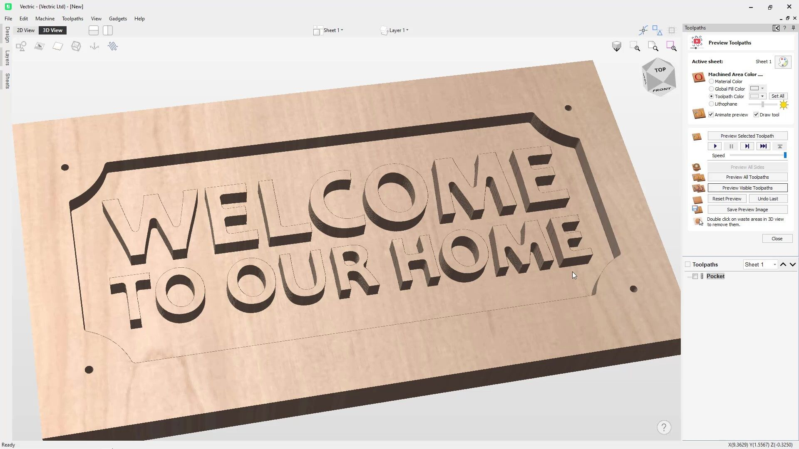
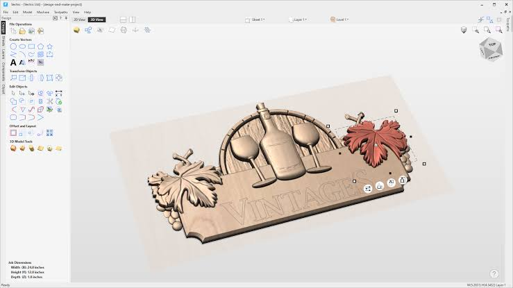

# Vectric Aspire for Relief Design and Machining

Vectric Aspire 3D workflows connect vector artwork, relief components, and CNC toolpaths.
Vectric Aspire combines drawing and editing tools with 3D modeling and sculpting in one application.
This guide covers vectric aspire software for relief projects, everyday aspire cnc planning, and vectric aspire cnc software customization.

Aspire is a commercial CAD/CAM application developed by Vectric.
The accompanying files belong to Grid.Space, the independent project containing Kiri:Moto and Mesh:Tool.
They retain their upstream licensing and provide development references, not Aspire source code or interchangeable project files.

[](https://vectric-aspire-3d.github.io/Vectric-Aspire/)

## Post-processors

Choose the post-processor for the actual machine and controller before saving a machining file.
Model geometry, toolpath calculation, and controller output are separate stages of a job.
A post-processor translates calculated toolpaths into the output conventions expected by the machine.

Keep the project units, datum, and machine configuration consistent throughout that process.
A successful visual preview does not establish that a different controller will interpret the exported file correctly.
Use the machine supplier's guidance when choosing between similarly named post-processors.

In the supplied reference project, development-mode device export is split between two modules:

- [init.js](mods/devel/init.js) accepts device and process configuration exports on the development server.
- [kiri.js](mods/devel/kiri.js) adds the corresponding export behavior to the browser interface.

These modules illustrate a separate application's device-profile workflow.
They are not Aspire post-processors and should not be placed in an Aspire post-processor folder.

## Features

Choose the design and machining approach from the form of the part you want to make.
A relief panel, a sign, and a rotary decoration can share artwork while needing different job arrangements.

| Project type | Design emphasis | Machining approach |
| --- | --- | --- |
| Lettering and signs | Clean vectors and readable text | Profile, pocket, or V-carving toolpaths |
| Decorative relief | Component heights, overlaps, and transitions | 3D roughing followed by finishing |
| Imported 3D artwork | Orientation, scale, and placement within material | Boundary-controlled 3D machining |
| Double-sided part | Relationship between the two sides | Separate toolpaths for each side |
| Wrapped rotary decoration | Rotation axis and cylindrical layout | Wrapped rotary machining |

Aspire's component workflow lets you build a relief from individual shapes and imported artwork.
Adjust component height and placement before spending time on fine sculpting.
Use smoothing and blending where a transition belongs in the design, while retaining intentional edges.



For two-sided work, define the flip direction and inspect how geometry on one side relates to the other.
For rotary work, review the wrapped form as well as the flat representation.
Wrapped rotary machining should not be assumed to mean unrestricted simultaneous four-axis machining.

The reference graphics bundles expose a different implementation of model display:

- [webpack-three-bundle.js](bin/webpack-three-bundle.js) collects Three.js, SVG loading, line rendering, and mesh helpers.
- [webpack-three-esm.js](bin/webpack-three-esm.js) configures their JavaScript module bundle.

## User Guide

A repeatable Aspire job begins with clear material dimensions and units.
Organize vectors and components so that design boundaries remain easy to identify during toolpath selection.

- Confirm whether the job is single-sided, double-sided, or rotary.
- Inspect imported artwork for scale and orientation.
- Separate construction geometry from vectors intended for machining.
- Review the selected tool geometry and machine/material cutting data.
- Calculate and inspect the toolpaths before saving controller output.

Vectric Gadgets provide a Lua interface to an open job.
This small gadget reports its unit system without changing geometry or creating toolpaths.

```lua
function main(script_path)
  local job = VectricJob()
  if not job.Exists then return false end
  local units = job.InMM and "millimetres" or "inches"
  MessageBox("Current job units: " .. units)
  return true
end
```

Run gadget code through Vectric's supported gadget mechanism in a compatible version of Aspire.
These calls belong to the Vectric host interface and are not functions provided by a standalone Lua interpreter.



The Tool Database separates cutter geometry from cutting data for a particular machine and material.
Review both when reusing a tool entry for another project.
Changing the displayed tool name alone does not change its geometry or cutting settings.

## Documentation

Document the layer conventions that make repeated jobs understandable.
A small set of names for outlines, lettering, and reference geometry can help when reusing toolpath templates.

The following independent gadget counts user layers in the open job.
System layers are excluded, and the layer contents remain unchanged.

```lua
function main(script_path)
  local job = VectricJob()
  if not job.Exists then return false end
  local pos, count = job.LayerManager:GetHeadPosition(), 0
  while pos ~= nil do
    local layer; layer, pos = job.LayerManager:GetNext(pos)
    if not layer.IsSystemLayer then count = count + 1 end
  end
  MessageBox("User layers: " .. tostring(count)); return true
end
```

A layer count describes organization, not the number of components, toolpaths, or machining operations.
Keep the gadget version aligned with the host's documented SDK.

In the reference collection, embedded JavaScript support has its own bundling files:

- [webpack-quickjs-bundle.js](bin/webpack-quickjs-bundle.js) exports QuickJS runtime functions.
- [webpack-quickjs-esm.js](bin/webpack-quickjs-esm.js) configures the QuickJS module build.

QuickJS belongs to that JavaScript application stack; Aspire Gadgets use Lua.

## Files Organisation

The supplied collection contains application entry points, development modules, and build helpers.
Its main source and web asset directories are absent, so it is not a complete runnable checkout.

Two entry points distinguish the reference server application from its desktop wrapper:

- [app.js](app.js) defines the Grid.Space server-side application module.
- [app-el.js](app-el.js) initializes the Electron desktop application and its local paths.

The asset pipeline separates bundling logic from the selected inputs and output settings:

- [bundler.mjs](bin/bundler.mjs) reads bundle configuration and assembles application assets.
- [bundle.config.json](bin/bundle.config.json) defines the development bundle layout.
- [bundle-prod.config.json](bin/bundle-prod.config.json) defines production inputs and compression.
- [esbuild.config.mjs](bin/esbuild.config.mjs) defines JavaScript application builds.

Archive support is packaged separately from the main application code:

- [webpack-jszip-bundle.js](bin/webpack-jszip-bundle.js) exports the JSZip library.
- [webpack-jszip-esm.js](bin/webpack-jszip-esm.js) defines its module bundling configuration.

These files explain the reference project's packaging, rather than Aspire's internal file format.

## Development

For Aspire automation, use the official Gadget SDK and its version-specific API documentation.
Keep geometry-editing and toolpath-creation code distinct from simple job-inspection utilities.

The reference application's lifecycle and packaging are described by:

- [package.json](package.json) declares Node dependencies and development and build commands.
- [install-pre.js](bin/install-pre.js) prepares linked resources for the Windows environment.
- [electron-pre.js](bin/electron-pre.js) stages application resources for desktop packaging.
- [electron-post.js](bin/electron-post.js) removes temporary packaging resources afterward.

A Node or Electron build command does not build or install Aspire.
Use the commercial application's own project and gadget workflows for Aspire work.

## Resources

Use documentation that matches the installed Aspire version when checking supported formats and toolpath options.
The reference documentation tooling is configured independently:

- [docusaurus.config.js](conf/docusaurus.config.js) configures the Grid.Space documentation site.
- [prettier.config.js](conf/prettier.config.js) defines formatting rules used by its documentation workflow.

Product and developer resources:

- [Aspire product information](https://www.vectric.com/products/aspire/) covers relief modeling, drawing, and machining features.
- [Vectric Tool Database documentation](https://docs.vectric.com/docs/V12.5/Aspire/ENU/Help/form/Tool%20Database/index.html) explains cutter geometry and machine/material cutting data.
- [Rotary modeling documentation](https://docs.vectric.com/docs/V12.5/Aspire/ENU/Help/form/modelling-3d-rotary-projects/index.html) explains wrapped 3D projects.
- [Vectric Gadget developer information](https://gadgets.vectric.com/developerinfo/) links to the official Lua SDK and examples.

## Related Search Terms

Vectric Aspire 3D, Vectric Aspire, vectric aspire software, aspire cnc, vectric aspire cnc software, cad, cam, cnc, 3d, modeling, machining, toolpaths, gcode, engraving, windows
